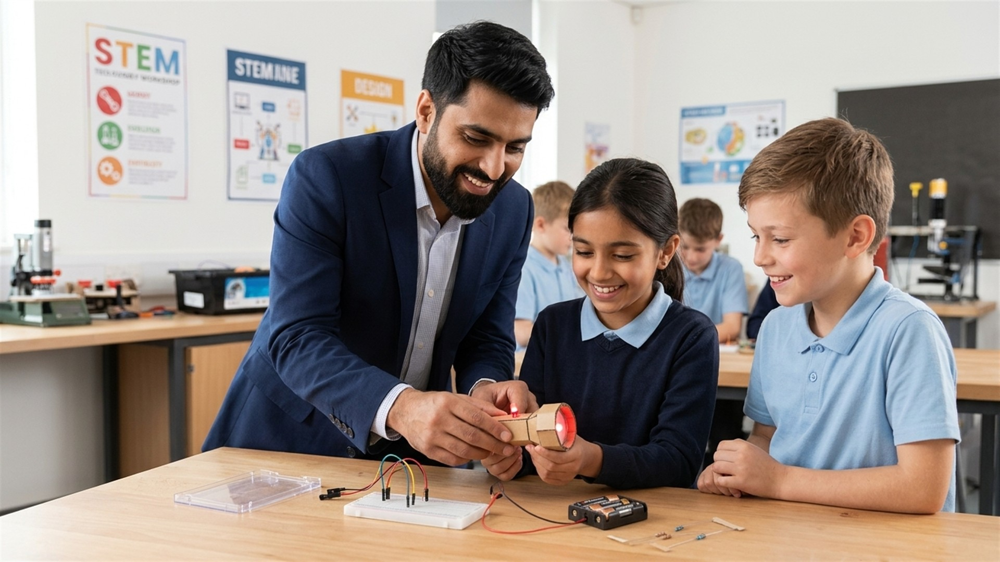
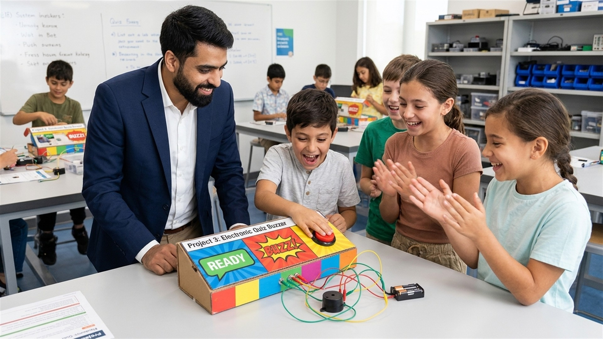
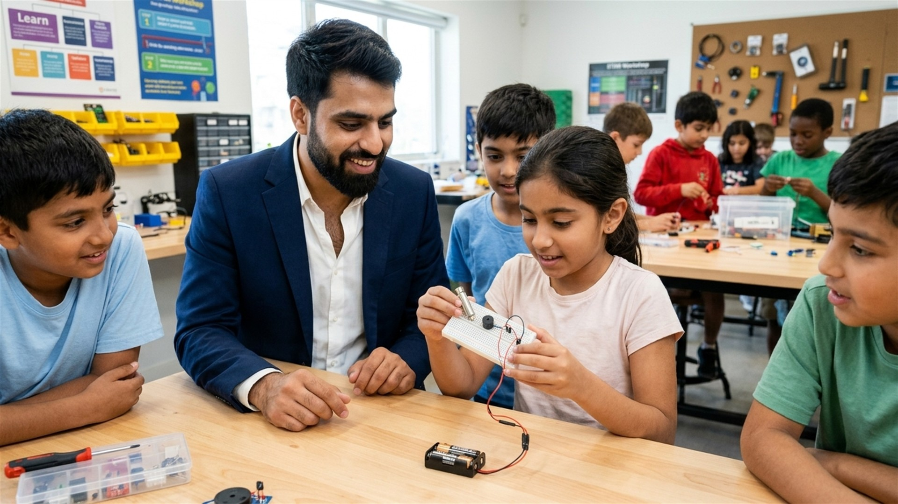
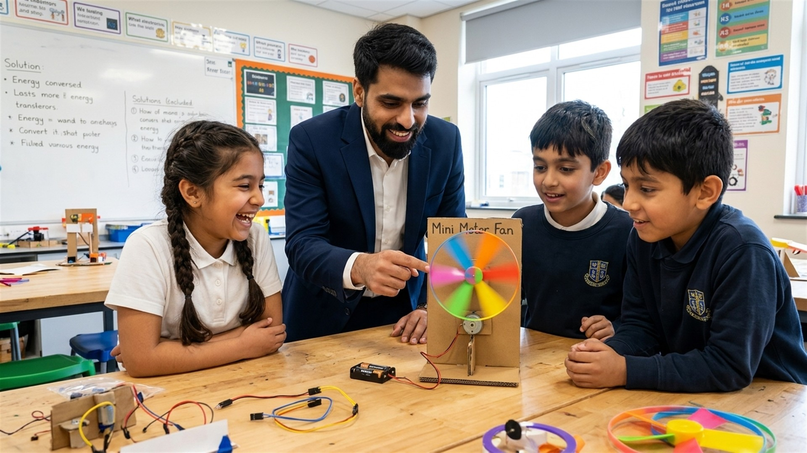

# Electronics STEM Kit for Kids (Ages 8–12)

**Offered by:** CS Technologies  
**Trainers:** Engr. Aamir Jamil (Lead AI, Robotics & STEAM Trainer) & Miss Zia Ul Ain (Supportive Trainer)  

---

## Programme Overview

- **Offered by:** CS Technologies
- **Trainers:** Engr. Aamir Jamil (Lead AI, Robotics & STEAM Trainer) & Miss Zia Ul Ain (Supportive Trainer)
- **Target Age:** 8–12 years
- **Duration:** 2 lessons, 2 hours per lesson
- **Total Learning Time:** 4 hours
- **Power Source:** Batteries
- **Learning Approach:** Basic theory, hands-on experiments, troubleshooting, and STEM challenges
- **Aim:** To make Students familiar with basic concepts of electronics and ready for future robotics and automation courses.
- **Included User Manual:** Comprehensive, illustrated step-by-step guidebook with circuit diagrams and project instructions.
- **Extended Project Capabilities:** In addition to the 6 core workshop projects, students can build numerous other DIY electronics circuits and experiments using the versatile components included in this kit.

## Programme Objectives

By the end of the programme, students will be able to:

- Identify basic electronic components.
- Explain simple concepts of voltage, current, resistance, and circuits.
- Build and test basic electronic circuits.
- Understand LED polarity and the purpose of resistors.
- Use buttons and switches to control outputs.
- Explore tilt and light sensors.
- Understand how electrical energy can produce sound, light, and movement.
- Identify common circuit faults and troubleshoot simple problems.

---

# Lesson 1: Electronics Fundamentals

**Duration:** 2 Hours

### Topics Covered

- Introduction to electronics and STEM.
- Battery, voltage, current, and resistance.
- Conductors and insulators.
- Breadboard and jumper wires.
- LED polarity and current-limiting resistors.
- Open and closed circuits.
- Basic circuit troubleshooting.

## Project 1: Mini LED Torch

**Objective:** Build a simple battery-powered torch.

### Components
- 2 × AA batteries
- Battery holder
- 1 LED
- 1 × 330Ω resistor
- Jumper wires
- Cardboard or another suitable mounting material

### Procedure
1. Identify the positive and negative battery terminals.
2. Identify the LED's anode (positive) and cathode (negative).
3. Connect battery positive to the resistor.
4. Connect the resistor to the LED anode.
5. Connect the LED cathode to battery negative.
6. Test the circuit and mount it on cardboard.

### Learning Outcome
Students understand a complete circuit, LED polarity, and the role of a resistor.

---

## Project 2: Push-Button Light

**Objective:** Control an LED using a push button.

### Components
- Battery holder and 2 × AA batteries
- 1 LED
- 1 × 330Ω resistor
- 1 push button
- Jumper wires

### Procedure
1. Build the basic LED circuit from Project 1.
2. Insert the push button in series with the circuit.
3. Press the button to complete the circuit.
4. Release the button to interrupt the circuit.
5. Observe and explain the difference between open and closed circuits.

### Learning Outcome
Students understand how switches control the flow of current.

---

## Project 3: Electronic Quiz Buzzer

**Objective:** Build a simple sound-output circuit for a classroom quiz.

### Components
- Battery supply compatible with the buzzer
- 1 active buzzer
- 1 push button
- Jumper wires
- Cardboard for a quiz panel

### Procedure
1. Check the buzzer's rated operating voltage.
2. Connect the buzzer and push button in series with a suitable battery supply.
3. Press the button to activate the buzzer.
4. Release the button to stop the sound.
5. Mount the circuit on a cardboard quiz panel.

### Learning Outcome
Students learn how electrical energy can produce sound.

### Lesson 1 Schedule

| Time | Activity |
|---|---|
| 0–15 min | Introduction and safety |
| 15–30 min | Component identification and breadboard |
| 30–55 min | Project 1: Mini LED Torch |
| 55–80 min | Project 2: Push-Button Light |
| 80–105 min | Project 3: Electronic Quiz Buzzer |
| 105–120 min | Testing, troubleshooting, and assessment |

---

# Lesson 2: Sensors, Alarms, and Motion

**Duration:** 2 Hours

### Topics Covered

- Introduction to input and output components.
- Sensors and their applications.
- Tilt switches.
- Light-dependent resistors (LDRs).
- DC motors and energy conversion.
- Testing, troubleshooting, and design challenges.

## Project 4: Tilt-Activated Alarm

**Objective:** Build an alarm that responds when its orientation changes.

### Components
- Battery supply compatible with the buzzer
- 1 active buzzer
- 1 tilt switch
- Jumper wires

### Procedure
1. Check the buzzer's rated voltage and current requirements.
2. Connect the tilt switch in series with the buzzer and suitable battery supply.
3. Observe the switch's behaviour in different orientations.
4. Gently tilt the circuit to activate or deactivate the buzzer.
5. Discuss possible applications, such as movement alarms.

### Learning Outcome
Students understand how a tilt switch can detect a change in orientation.

---

## Project 5: Light Detector

**Objective:** Investigate how light affects an LDR.

### Components
- 1 light-dependent resistor (LDR)
- 1 LED
- 1 × 330Ω resistor
- 2 × AA batteries and battery holder
- Jumper wires
- Multimeter (optional)

### Procedure
1. Observe the LDR under bright light.
2. Shade the LDR and compare its behaviour.
3. If a multimeter is available, measure its resistance in bright and dark conditions.
4. Build a simple series circuit using the LDR, LED, resistor, and battery.
5. Compare the LED's behaviour under different lighting conditions.

### Learning Outcome
Students discover that an LDR's resistance changes with light intensity.

**Note:** This basic series circuit may not automatically switch the LED on in darkness. An additional transistor or comparator circuit is needed for a reliable automatic night light.

---

## Project 6: Mini Motor Fan

**Objective:** Use a DC motor to produce movement and airflow.

### Components
- 1 small 3–6V DC motor
- Compatible battery supply
- Jumper wires
- Cardboard motor support
- Lightweight, purpose-made plastic propeller

### Procedure
1. Identify the motor terminals.
2. Check the motor's rated voltage and the battery supply.
3. Secure the motor firmly to a cardboard support.
4. Attach a suitable lightweight propeller securely.
5. Connect the motor briefly to the compatible power supply.
6. Observe the rotation and airflow.
7. Discuss how electrical energy is converted into mechanical energy.

### Learning Outcome
Students understand how an electric motor produces motion.

### Lesson 2 Schedule

| Time | Activity |
|---|---|
| 0–15 min | Review and introduction to sensors and motors |
| 15–40 min | Project 4: Tilt-Activated Alarm |
| 40–70 min | Project 5: Light Detector |
| 70–100 min | Project 6: Mini Motor Fan |
| 100–115 min | Design challenge and testing |
| 115–120 min | Review and assessment |

---

# Required Kit Components

| Component | Quantity |
|---|---:|
| Mini breadboard | 1 |
| LEDs (mixed colours) | 6 |
| Resistors (220Ω, 330Ω, 1kΩ) | 10 |
| 2 × AA battery holder | 1 |
| AA batteries | 2 |
| Jumper wires | 10 |
| Push buttons | 2 |
| Active buzzer | 1 |
| Crocodile clips | 2 |
| Storage box and labels | 1 |
| Small DC motor (3–6V) | 1 |
| LDR | 1 |
| Tilt switch | 1 |
| Detailed Illustrated User Manual & Project Guidebook | 1 |

**Comprehensive Manual & Extended Learning:** Each kit includes a detailed, child-friendly user manual featuring clear pictorial wiring guides, component descriptions, safety rules, troubleshooting steps, and detailed instructions for many additional hands-on electronics projects that students can build and explore at home using this same kit.

An IR sensor module can be added later as an optional extension.

---

# Safety Guidelines

- Use only low-voltage battery power.
- Disconnect the battery before changing circuit connections.
- Always use an appropriate current-limiting resistor with an LED.
- Check the operating voltage and current requirements of the buzzer and motor.
- Do not connect a motor directly to an IR sensor output.
- Secure the motor and propeller before applying power.
- Keep fingers, hair, and loose clothing away from moving parts.
- Do not short-circuit batteries or connect battery terminals directly together.
- Provide adult supervision throughout the activities.

---

# Assessment and Expected Outcomes

At the end of the programme, students should be able to:

- Draw and explain a simple LED circuit.
- Identify LED polarity and explain why a resistor is used.
- Explain how a push button opens and closes a circuit.
- Build a basic sound alarm.
- Describe how a tilt switch and LDR respond to environmental changes.
- Explain how a DC motor converts electrical energy into motion.
- Identify and correct at least one simple circuit fault.

## Final Project Summary

| Project | Main Concept | Output |
|---|---|---|
| 1. Mini LED Torch | Complete circuit and LED polarity | Light |
| 2. Push-Button Light | Switching | Controlled light |
| 3. Electronic Quiz Buzzer | Electrical-to-sound energy conversion | Sound |
| 4. Tilt-Activated Alarm | Tilt sensing | Alarm |
| 5. Light Detector | Light-sensitive resistance | Measured/observed response |
| 6. Mini Motor Fan | Electrical-to-mechanical energy conversion | Movement and airflow |

**Programme Outcome:** Students complete six practical electronics projects during the workshop and gain the foundational skills to construct many other self-guided projects using the included kit and detailed user manual—mastering the fundamentals of circuits, switching, sensors, sound, and motion without requiring Arduino, programming, or soldering.
