# Hands-On Robotics & Applied STEM Masterclass (Ages 8–12)

**Offered by:** CS Technologies  
**Instructional & Management Team:** Engr. Aamir Jamil (Lead AI, Robotics, STEAM & CEH Trainer), Miss Zia Ul Ain (Supportive Trainer · Circuit Guidance) & Awais Paracha (Manager · Operations & Quality)  

---

## Programme Overview

- **Offered by:** CS Technologies
- **Target Age:** 8–12 years (Grades 3–5)
- **Duration:** 2 Days, 4 Hours per day
- **Total Learning Time:** 8 Hours Total
- **Power Source:** Safe Low-Voltage Battery Power (3V Nominal DC)
- **Pedagogical Approach:** Hands-on circuit construction, physics intuition, diagnostic troubleshooting, autonomous vehicle engineering, and timed obstacle arena challenges.
- **Course Aim:** To provide students with foundational mastery of electrical circuits, sensors, and electromechanics on Day 1, and elevate them to applied autonomous robotics, chassis mechanics, and collision-avoidance engineering on Day 2.
- **Included User Manual:** Comprehensive, child-friendly illustrated step-by-step guidebook with full schematics, pictorial wiring diagrams, and bonus home DIY blueprints.
- **Extended Project Capabilities:** In addition to the 10 masterclass builds, students can explore many additional home electronics projects using the versatile components in their individual hardware kits.

---

## Master Programme Objectives

By the end of this 2-day intensive masterclass, students will be able to:

1. **Circuits & Polarity:** Construct complete, solderless circuit loops on breadboards, observe LED polarity, and calculate resistor requirements to prevent component burnout.
2. **Switching & Control:** Implement momentary and continuous switching mechanisms to control light, sound, and mechanical motion.
3. **Sensory Transduction:** Calibrate environmental response systems using mechanical tilt switches and optical light-dependent resistors (LDRs).
4. **Electromechanics & Propulsion:** Harness direct-current (DC) electromagnetic motors for aerodynamic propeller thrust and directional kinetic rotation.
5. **Compound Automation:** Combine multiple sensors in series and parallel logic to construct automated smart devices (e.g., dual-sensor night sentinels).
6. **Biomimetic Locomotion:** Harness Eccentric Rotating Mass (ERM) kinetic vibrations to drive autonomous bristle-skating robots without traditional gears.
7. **Wheeled Robotics Engineering:** Assemble dual-drive rover chassis, align drive axles, and install DPDT polarity switches for manual bi-directional steering.
8. **Optical Proximity Radar:** Wire and tune 940nm infrared (IR) reflection sensors for autonomous obstacle detection and collision braking.
9. **Diagnostics & Reverse-Engineering:** Rapidly identify, isolate, and correct real circuit faults under timed challenge conditions.
10. **Tactical Navigation:** Successfully steer and optimize rovers across a 3-meter obstacle slalom, incline ramp, and arena speed trials.

---

# Day 1: Electronics Fundamentals, Sensors & Electromechanics

**Duration:** 4 Hours (Morning + Afternoon Sessions)  
**Track Focus:** Component physics, solderless breadboard architecture, single-sensor circuits, and kinetic propulsion.

### Theory & Core Concepts
- Atomic nature of electricity: Voltage, current loops, and resistance.
- Solderless breadboard internal bus architecture (power rails vs. terminal rows).
- LED polarity (Anode vs. Cathode) and current-limiting resistor protection (Ohm's Law intuition).
- Open vs. closed circuits and manual momentary switching.
- Acoustic transducers: Piezoelectric sound wave generation.
- Gravitational tilt detection via mercury-free rolling ball contacts.
- Optical physics: Cadmium sulfide (CdS) photoresistors and ambient light variance.
- Electromagnetic motor rotation, torque, and miniature propeller aerodynamics.

---

## Project 1: Mini LED Torch

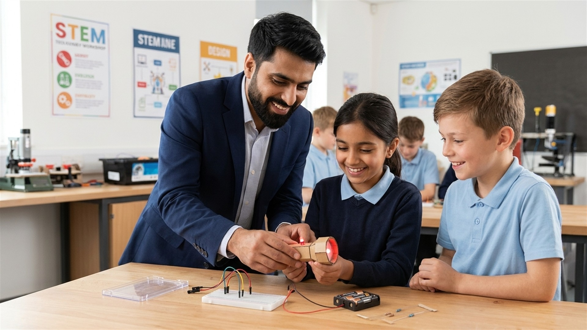

**Objective:** Build a portable, battery-powered directional torch on a solderless breadboard.

### Components
- Mini breadboard
- 2 × AA battery holder & batteries (3V)
- 1 × Bright LED (5mm White/Blue)
- 1 × 330Ω current-limiting resistor
- Flexible jumper wires
- Rigid cardboard mounting plate

### Procedure
1. Identify positive (red) and negative (black) leads from the battery pack.
2. Insert the 330Ω resistor into the positive breadboard rail to limit incoming current.
3. Identify the LED anode (longer leg / positive) and cathode (shorter flat side / negative).
4. Connect the resistor terminal to the LED anode via breadboard tie-points.
5. Return the LED cathode back to the negative battery terminal to complete the loop.
6. Verify steady illumination and mount the assembly securely on the cardboard torch frame.

### Learning Outcome
Students master complete circuit loops, understand LED polarity, and realize why current-limiting resistors are mandatory to protect semiconductor components.

---

## Project 2: Push-Button Light

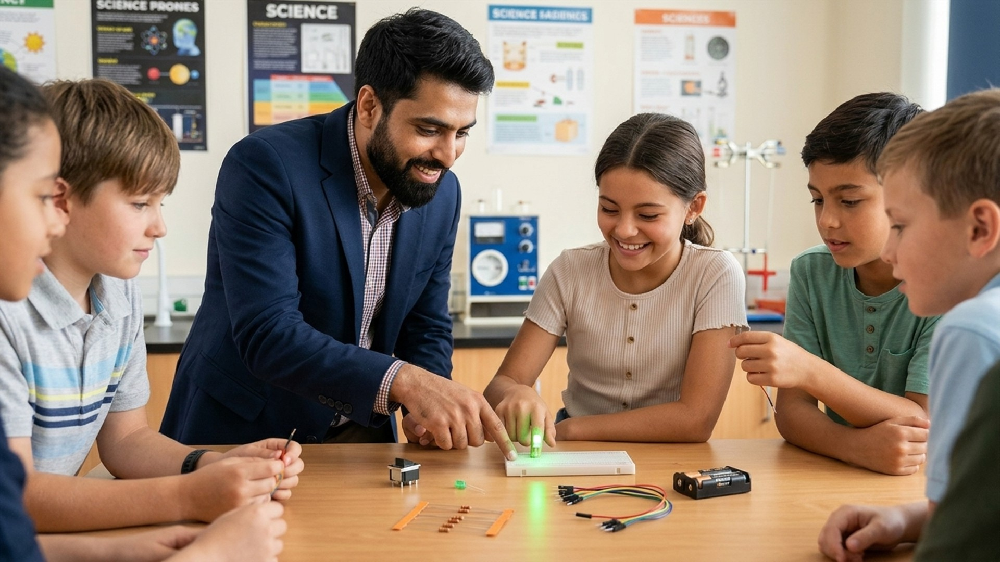

**Objective:** Control an LED circuit interactively using a tactile momentary push button.

### Components
- Mini breadboard & battery pack (3V)
- 1 × LED (Red or Green)
- 1 × 330Ω resistor
- 1 × 4-pin tactile push button
- Flexible jumper wires

### Procedure
1. Re-use the basic LED circuit loop established in Project 1.
2. Straddle the tactile push button across the central breadboard divider trench.
3. Route the positive voltage lead through the normally-open (NO) contact pins of the switch.
4. Press the tactile plunger down to close the internal metal dome contact and light the LED.
5. Release the plunger to observe immediate circuit interruption.
6. Test rapid pulsed switching and discuss real-world applications (doorbells, keyboard keys).

### Learning Outcome
Students understand how mechanical switching breaks and restores electrical pathways to achieve user-controlled inputs.

---

## Project 3: Electronic Quiz Buzzer

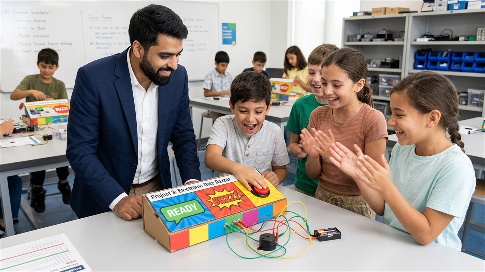

**Objective:** Construct an audible signaling station for interactive classroom game shows and quizzes.

### Components
- Mini breadboard & battery supply (3V)
- 1 × Active piezoelectric buzzer (3–5V)
- 1 × Tactile push button
- Jumper wires
- Cardboard quiz console plate

### Procedure
1. Observe the polarity markings on the active buzzer casing (+ sticker / long leg).
2. Wire the positive battery terminal to the input pin of the tactile push button.
3. Connect the output pin of the push button to the positive buzzer terminal.
4. Connect the negative buzzer pin directly to the battery ground rail.
5. Depress the push button to complete the circuit and generate a sharp 1.2kHz acoustic tone.
6. Mount on the student quiz console and test buzzer responsiveness under game-show conditions.

### Learning Outcome
Students discover how electrical energy is converted into acoustic sound waves through piezoelectric vibration.

---

## Project 4: Tilt-Activated Motion Alarm

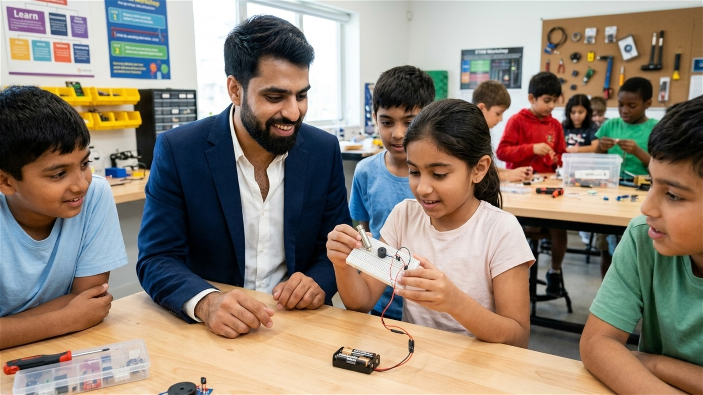

**Objective:** Construct a gravity-sensing intrusion alarm that sounds whenever the device is tilted or moved.

### Components
- Mini breadboard & battery supply (3V)
- 1 × Active buzzer
- 1 × SW-520D mercury-free rolling-ball tilt switch
- 1 × Red warning LED & 220Ω resistor
- Jumper wires

### Procedure
1. Examine the internal construction of the brass cylindrical tilt switch (dual internal electrodes with conductive rolling ball).
2. Mount the tilt switch vertically on the breadboard so the internal ball rests on the lower contacts.
3. Wire the tilt switch in series with the active buzzer and warning LED.
4. When kept level (0°), the circuit remains closed or open depending on orientation.
5. Incline the breadboard past 45°: observe the rolling ball bridge/break the circuit, triggering the audible alarm and LED strobe.
6. Calibrate orientation sensitivity for vehicle anti-roll and backpack theft detection.

### Learning Outcome
Students learn the principles of gravitational orientation sensors and mechanical inertial switching.

---

## Project 5: Light Detector (LDR Optical Sensor)

**Objective:** Investigate ambient optical sensing using a cadmium sulfide (CdS) photoresistor.

### Components
- Mini breadboard & battery supply (3V)
- 1 × Light-Dependent Resistor (LDR / photoresistor)
- 1 × High-brightness LED (Green)
- 1 × 220Ω resistor
- Jumper wires

### Procedure
1. Inspect the serpentine conductive photo-conductive track on the face of the LDR.
2. Wire the LDR in series with the LED, current-limiting resistor, and 3V battery supply.
3. Expose the sensor to direct bright ambient light: observe the LED glow with high intensity as LDR resistance drops below 500Ω.
4. Cup your hand over the LDR to simulate darkness: observe the LED dim significantly as LDR resistance surges past 50,000Ω (50kΩ).
5. Record the behavioral differences between bright sunlight, ambient classroom lighting, and complete shadow.

### Learning Outcome
Students discover variable resistance and understand how electronic sensors convert physical environmental phenomena (light intensity) into modulated electrical current.

---

## Project 6: Mini Motor Fan & Kinetic Propulsion

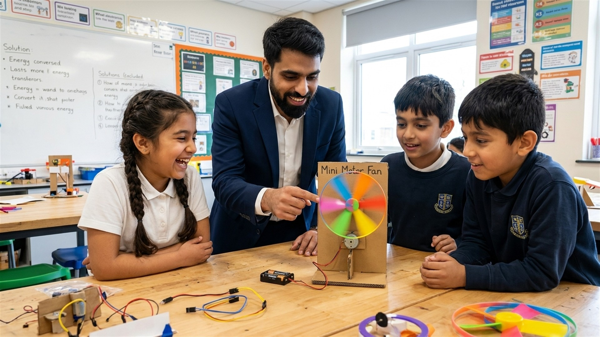

**Objective:** Harness direct-current electromagnetic motors to produce mechanical rotational motion and aerodynamic airflow.

### Components
- 1 × Small DC electric motor (3–6V hobby motor)
- 1 × 3-blade miniature plastic propeller
- 1 × Tactile push button or slide switch
- Crocodile clips & jumper wires
- Cardboard motor mounting chassis

### Procedure
1. Inspect the dual terminal tabs of the DC electric motor.
2. Firmly press the plastic propeller hub onto the 2mm motor drive shaft.
3. Secure the motor body securely to the rigid mounting bracket to counteract startup torque.
4. Connect the motor leads across the 3V battery supply through a toggle button.
5. Engage power and observe propeller spin direction and generated airflow draft.
6. Swap the positive and negative leads: observe instantaneous reversal of propeller rotation and airflow direction.

### Learning Outcome
Students understand electrical-to-mechanical energy conversion, electromagnetic rotational torque, polarity-dependent direction reversal, and basic propulsion aerodynamics.

---

### Day 1 Comprehensive 4-Hour Schedule

| Timeline | Module & Stage | Workshop Activity & Build Milestone |
|---|---|---|
| **00–20 min** | Safety & Tool Orientation | Welcome, lab safety rules, 3V low-voltage briefing, breadboard bus architecture |
| **20–55 min** | **Project 1** | Mini LED Torch: Solderless loop assembly, LED polarity & resistor sizing |
| **55–90 min** | **Project 2** | Push-Button Light: Momentary tactile switching & loop interruption |
| **90–125 min** | **Project 3** | Electronic Quiz Buzzer: Piezoelectric sound generation & panel mount |
| **125–140 min** | Hydration & Sort Break | Mid-day rest, component inspection & tool inventory check |
| **140–170 min** | **Project 4** | Tilt-Activated Alarm: Gravitational ball calibration & security siren |
| **170–200 min** | **Project 5** | Light Detector: LDR optical resistance modulation & shadow testing |
| **200–225 min** | **Project 6** | Mini Motor Fan: DC motor electromechanics, propeller spin & airflow thrust |
| **225–240 min** | Diagnostic Challenge | Day 1 "Silent Circuit" reverse-engineering drill & fault isolation contest |

---

# Day 2: Applied Robotics, Compound Systems & Arena Grand Prix

**Duration:** 4 Hours (Morning + Afternoon Sessions)  
**Track Focus:** Compound multi-sensor logic, autonomous locomotion without wheels, motorized rover engineering, infrared radar, and grand arena obstacle trials.

### Theory & Core Concepts
- Compound multi-sensor logic: Series (AND) and parallel (OR) sensor configurations.
- Eccentric Rotating Mass (ERM) physics: Unbalanced rotating center-of-gravity and vibrational locomotion.
- Wheeled robot chassis design: Wheelbase geometry, traction friction, and drive axle alignment.
- Bi-directional vehicle steering via Double-Pole Double-Throw (DPDT) polarity reversal switches.
- Active optical sensors: 940nm Infrared (IR) emitter-receiver pairs, surface reflectivity, and threshold potentiometers.
- Autonomous collision avoidance and automatic electronic braking principles.
- Real-world tactical navigation: Slalom trajectory, 15° ramp climb momentum, and speed stabilization.
- Junior Robotics Engineer peer review and official graduation ceremony.

---

## Project 7: Dual-Sensor Smart Night Sentinel (Compound Automation)

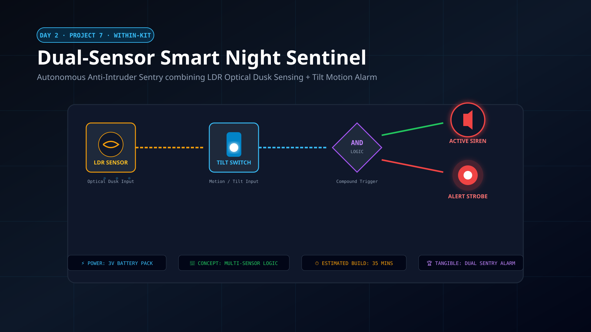

**Objective:** Combine optical and gravitational sensors into a compound anti-theft night security alarm.

### Components
- Mini breadboard & 3V battery supply
- 1 × Light-Dependent Resistor (LDR)
- 1 × Rolling-ball tilt switch sensor
- 1 × Active buzzer
- 1 × High-brightness Red LED & 220Ω resistor
- Jumper wires

### Procedure
1. Wire the LDR optical sensor and tilt switch in series logic so that current can only flow when ambient conditions satisfy both triggers.
2. Connect the output of the compound sensor loop to the active buzzer and warning LED.
3. Test state 1: In broad daylight, tilt the breadboard: buzzer remains silent because LDR resistance is low/high depending on wiring logic.
4. Test state 2: Place the device in a dark drawer or simulate nighttime darkness by shading the LDR.
5. Now gently disturb or tilt the unit: the circuit triggers instantly, flashing the LED and sounding the anti-theft siren.
6. Calibrate sensitivity so the system acts as an autonomous perimeter intrusion sentinel.

### Learning Outcome
Students master multi-sensor compound logic and discover how real smart-home and perimeter security systems integrate multiple environmental sensors to eliminate false alarms.

---

## Project 8: Autonomous Vibro-Bot / BristleBot (Locomotion Dynamics)

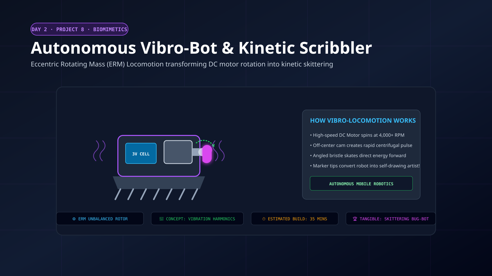

**Objective:** Build an autonomous vibrating robot that travels rapidly across smooth surfaces without traditional drive wheels.

### Components
- 1 × High-RPM micro DC motor
- 1 × Eccentric Rotating Mass (ERM) offset vibration cam
- 1 × Compact battery power cell (3V)
- 1 × Angled bristle skate chassis
- Adhesive mounting pads & flexible jumper leads

### Procedure
1. Mount the unbalanced ERM cam securely onto the motor output shaft.
2. Secure the motor firmly to the bristle chassis using heavy-duty dampening foam tape.
3. Affix the battery holder directly to the central chassis to establish a low center-of-gravity.
4. Connect the power leads: as the motor spins, the off-center rotating mass generates intense kinetic vibrations (harmonic oscillation).
5. The angled flexible bristle skates translate downward vibrational pulses into rapid forward hopping locomotion.
6. Experiment with bristle trimming and ballast placement to create straight-line sprinters or chaotic perimeter patrollers.

### Learning Outcome
Students learn the physics of eccentric rotational dynamics, biomimetic locomotion, kinetic vibration energy, and mechanical propulsion without wheels.

---

## Project 9: Motorized Dual-Drive STEM Rover (Wheeled Drivetrain)

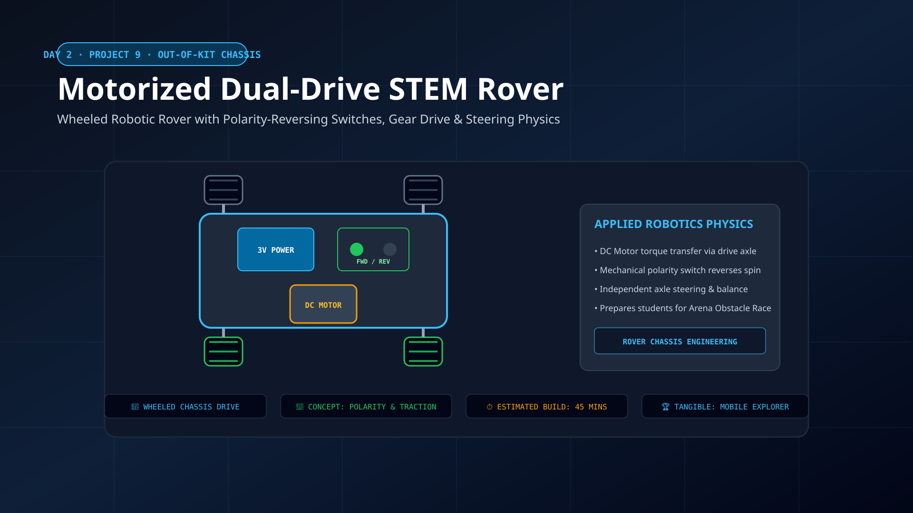

**Objective:** Assemble a motorized wheeled rover chassis equipped with a polarity-reversing direction switch.

### Components
- 1 × Modular lightweight acrylic/wood robot chassis plate
- 2 × DC drive motors & high-traction rubber drive wheels
- 1 × Smooth omnidirectional front castor wheel
- 1 × 6-terminal DPDT polarity-reversing rocker switch
- 2 × AA battery holder with power leads
- Motor mounting brackets, screws & connecting wires

### Procedure
1. Mount the dual DC gear motors to the chassis baseplate using mounting brackets.
2. Press the high-traction rubber wheels firmly onto the motor axles.
3. Install the low-friction front castor wheel to create a stable 3-point driving platform.
4. Wire the DPDT switch in an "X-crossover" configuration across the motor terminals to enable forward and reverse polarity switching.
5. Connect the battery pack to the center terminals of the DPDT switch.
6. Power on the rover: toggle the switch to drive forward, stop, and reverse smoothly across the floor.

### Learning Outcome
Students understand mobile robotic drivetrain mechanics, wheel-to-ground friction, 3-point balance geometry, and polarity-controlled motor reversal.

---

## Project 10: Infrared (IR) Autonomous Obstacle Radar Module

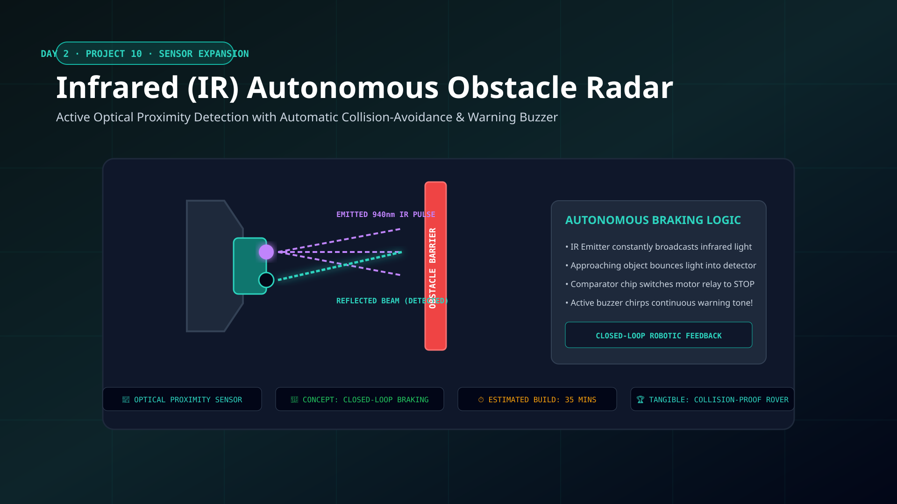

**Objective:** Wire and calibrate an active infrared proximity radar module for collision detection and automated rover braking.

### Components
- 1 × 3-pin Active Infrared (IR) obstacle proximity sensor module
  - 940nm IR transmitter diode
  - IR phototransistor photodiode receiver
  - LM393 voltage comparator & calibration potentiometer
- 1 × Active buzzer or Red stop LED
- Breadboard & 3V battery supply
- Jumper wires

### Procedure
1. Connect the IR module VCC pin to 3V positive, GND to ground, and monitor the digital OUT pin.
2. Place a solid obstacle (hand, cardboard wall) 5cm to 10cm in front of the optical sensor lenses.
3. Observe invisible 940nm infrared light reflect off the surface into the receiver diode.
4. Turn the onboard micro-potentiometer using a tuning screwdriver until the onboard detection indicator LED illuminates sharply at the desired distance.
5. Connect the OUT pin to an indicator buzzer or motor cutoff switch to trigger automated stopping whenever a wall is detected.
6. Test detection reliability across dark vs. light and reflective vs. matte obstacle surfaces.

### Learning Outcome
Students master optical reflection principles, infrared frequency spectrums, analog-to-digital sensor comparison, and autonomous robotic collision avoidance.

---

## Activity 1: The 3-Meter "Mars Rover" Obstacle Arena Challenge

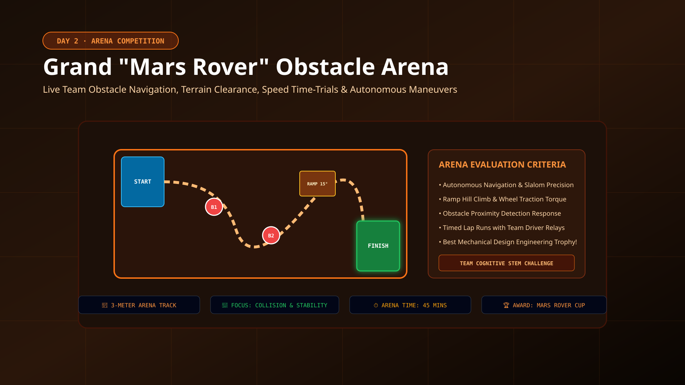

**Objective:** Test rover agility, speed, and collision avoidance on a custom 3-meter tactical arena track.

### Arena Specifications
- **Track Length:** 3.0 Meters
- **Surface:** High-traction rubberized competition roll-out mat
- **Hazard 1 (The Martian Slalom):** 4 zig-zag slalom pylons spaced 50cm apart
- **Hazard 2 (Olympus Mons Incline):** 15° angled ramp climb requiring steady motor torque
- **Hazard 3 (Boulder Choke Point):** Narrow corridor flanked by tactile obstacles
- **Finish Gate:** Precision stopping box within 20cm of the terminal barrier

### Challenge Rules
1. Student engineering teams deploy their tuned rovers at the Starting Line.
2. Vehicles must navigate through the slalom gates and ascend the 15° incline ramp without tumbling.
3. Bonus points awarded for rovers that brake automatically before colliding with the terminal barrier using their IR sensors.
4. Teams receive two practice runs to adjust tire traction, chassis ballast, and switch timing before their official timed trial.

### Learning Outcome
Applied engineering optimization, real-time kinematics troubleshooting, mass balance calibration, and team collaboration under competitive arena conditions.

---

## Activity 2: Speed-Wire Reverse-Engineering Relay & Certification

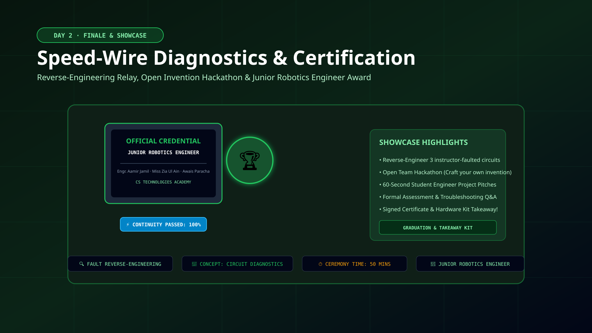

**Objective:** Demonstrate hands-on hardware mastery through a fast-paced diagnostic relay, open innovation showcase, and certification ceremony.

### Relay Format
- **Round 1 (The Fault Hunter Drill):** Each team receives a pre-faulted mystery circuit (e.g., reversed LED polarity, loose ground jumper, open switch). Teams must diagnose the symptom, isolate the defect, and restore operation against the clock.
- **Round 2 (Speed-Wire Schematic Sprint):** Teams compete to wire a compound sensor circuit from a schematic blueprint with 100% precision in under 180 seconds.
- **Round 3 (Open Hackathon Showcase):** Cadets demonstrate their custom rover or vibro-bot modifications to peers and instructors.
- **Official Award Ceremony:** Presentation of the **Junior Robotics Engineer Certificate of Completion** signed by Engr. Aamir Jamil and Awais Paracha.

### Learning Outcome
High-speed schematic reading, systematic fault tracing, cooperative engineering communication, and pride of accomplishment in practical STEM hardware.

---

### Day 2 Comprehensive 4-Hour Schedule

| Timeline | Module & Stage | Workshop Activity & Engineering Milestone |
|---|---|---|
| **00–20 min** | Systems Briefing | Day 1 review, Day 2 robotics engineering roadmap & chassis mechanics briefing |
| **20–55 min** | **Project 7** | Dual-Sensor Smart Night Sentinel: LDR + Tilt compound logic automation |
| **55–95 min** | **Project 8** | Autonomous Vibro-Bot: ERM kinetic vibration locomotion & bristle skates |
| **95–135 min** | **Project 9** | Motorized Dual-Drive STEM Rover: Chassis assembly & DPDT polarity steering |
| **135–150 min** | Pit Stop Break | Drivetrain calibration, tire traction tuning & battery power check |
| **150–185 min** | **Project 10** | Infrared (IR) Obstacle Radar: Optical reflection tuning & auto-braking |
| **185–225 min** | **Arena Grand Prix** | The 3-Meter "Mars Rover" Obstacle Course, 15° Ramp & Slalom Speed Trials |
| **225–240 min** | Showcase & Awards | Speed-Wire Reverse-Engineering Relay, Peer Showcase & Certification Ceremony |

---

# Hardware Bill of Materials (Complete 2-Day Kit)

Every student receives a complete, re-usable hardware kit for Day 1, plus full access to Day 2 out-of-kit chassis assemblies and arena trial facilities.

### Part A: Day 1 Foundation Hardware & Sensor Kit (Per Cadet)

| Item # | Component Specification | Educational & Engineering Purpose | Quantity |
|:---:|---|---|:---:|
| 1 | **Mini Solderless Breadboard** | 400-point solderless circuit prototyping platform | 1 |
| 2 | **LED Assortment (Red, Green, Yellow, Blue, White)** | Visual output indicators, diode polarity training | 6 |
| 3 | **Carbon Film Resistors (220Ω, 330Ω, 1kΩ)** | Current-limiting protection & voltage division | 10 |
| 4 | **2 × AA Battery Enclosure with Switch** | Safe 3V low-voltage DC power supply | 1 |
| 5 | **Alkaline AA Batteries** | Portable chemical-to-electrical energy cells | 2 |
| 6 | **Flexible M-M Jumper Wires** | Rapid solder-free breadboard bus routing | 10 |
| 7 | **Tactile Momentary Push Buttons** | Manual switching, circuit loop interruption | 2 |
| 8 | **Active Piezoelectric Buzzer (3–5V)** | Audible acoustic signal tone generator | 1 |
| 9 | **Insulated Crocodile Clip Leads** | Secure mechanical & terminal wire gripping | 2 |
| 10 | **Micro DC Electric Motor (3–6V)** | Electromechanical kinetic rotation & propeller drive | 1 |
| 11 | **Light-Dependent Resistor (CdS Photoresistor)** | Ambient optical light intensity transducer | 1 |
| 12 | **Rolling-Ball Tilt Switch Sensor (SW-520D)** | Gravitational tilt & orientation movement detector | 1 |
| 13 | **Cadet Hardware Case & Component Organizer** | Component accountability & individual storage | 1 |
| 14 | **Illustrated Student Guidebook & Project Manual** | Step-by-step schematics, troubleshooting & home DIY guides | 1 |

### Part B: Day 2 Applied Robotics, Chassis & Arena Pack (Per Cadet / Team)

| Item # | Component Specification | Educational & Robotics Purpose | Quantity |
|:---:|---|---|:---:|
| 15 | **Modular Lightweight Robot Chassis Baseplate** | Pre-drilled chassis plate with dual motor mounts | 1 Set |
| 16 | **High-Traction Rubber Drive Wheels & Front Castor** | Ground friction grip & 3-point rolling rover balance | 2 Wheels + 1 Castor |
| 17 | **DPDT Polarity Reversing Rocker Switch (6-Pin)** | Bi-directional forward / reverse motor steering control | 1 |
| 18 | **Eccentric Rotating Mass (ERM) Unit & Bristle Skates** | Harmonic vibration generator for Vibro-Bot hopping locomotion | 1 Pack |
| 19 | **Active Infrared (IR) Proximity Radar Module** | 940nm optical reflection sensor with LM393 comparator | 1 Module |
| 20 | **3-Meter Competition Arena Mat & Obstacle Slalom Pack** | Standardized tactical obstacle course, pylons & 15° ramp | Arena Facility |

---

# Safety Guidelines & Lab Protocol

Safety is paramount in all CS Technologies workshops. Our curriculum adheres strictly to child-safe engineering principles:

- **Strictly Low-Voltage DC Power (3V Nominal):** Zero mains electricity or high voltages are permitted in the laboratory.
- **100% Solder-Free:** All electrical connections utilize breadboard spring clips, terminal blocks, and insulated jumper leads. No hot soldering irons or toxic solder fumes.
- **Component Protection Resistors:** Resistors are always placed in series with LEDs to prevent overheating and thermal runaway.
- **Motor & Kinetic Clearance:** Long hair must be tied back and loose jewelry removed prior to operating spinning propellers and rover drivetrains.
- **Battery Safety:** Battery packs must be turned off before reconfiguring breadboard connections. Short-circuits (direct positive-to-negative connection) are strictly monitored and prevented.
- **Low Student-to-Instructor Ratio:** Certified lead trainers and lab mentors provide continuous hands-on oversight throughout all build phases.

---

# Assessment Criteria & Expected Learning Outcomes

Students are evaluated continuously across both days through tangible build milestones, diagnostic problem solving, and arena trial performance:

1. **Circuit Loop Proficiency:** Accurately breadboard closed circuits from schematic diagrams without mentor intervention.
2. **Polarity Accuracy:** Consistently identify anode/cathode on diodes and reverse DC motor polarity intentionally.
3. **Sensor Tuning:** Calibrate LDR optical response and SW-520D tilt sensitivity accurately for target environments.
4. **Autonomous Mechanical Assembly:** Build functioning Vibro-Bot and wheeled rover mechanisms that travel smoothly without stalling.
5. **Radar Proximity Configuration:** Tune IR sensor potentiometers to detect obstacles reliably within 5–10cm.
6. **Diagnostic Independence:** Successfully isolate and repair at least one simulated open or short circuit fault within 3 minutes during the Speed-Wire Relay.

---

## Master Project & Challenge Summary Matrix

| # | Masterclass Project / Activity | Day | Primary STEM & Robotics Concept | Tangible Working Output |
|:---:|---|:---:|---|---|
| **1** | **Mini LED Torch** | Day 1 | Complete Circuit Loop & Diode Polarity | Controlled Directional Illumination |
| **2** | **Push-Button Light** | Day 1 | Mechanical Momentary Switching | Interactive Light Control Station |
| **3** | **Electronic Quiz Buzzer** | Day 1 | Electrical-to-Acoustic Conversion | High-Frequency Game Tone Signaling |
| **4** | **Tilt-Activated Alarm** | Day 1 | Gravitational Orientation Sensing | Motion-Triggered Security Siren |
| **5** | **Light Detector (LDR)** | Day 1 | Light-Dependent Variable Resistance | Optical Ambient Sensor Modulation |
| **6** | **Mini Motor Fan** | Day 1 | Electromechanical Energy Conversion | High-Speed Propeller Airflow & Thrust |
| **7** | **Smart Night Sentinel** | Day 2 | Compound Multi-Sensor Logic (LDR + Tilt) | Automated Anti-Theft Night Alert |
| **8** | **Autonomous Vibro-Bot** | Day 2 | ERM Oscillation & Kinetic Vibration | Biomimetic Bristle-Skate Hopping Locomotion |
| **9** | **Motorized STEM Rover** | Day 2 | Drivetrain Mechanics & DPDT Polarity Control | Bi-Directional Mobile Wheeled Vehicle |
| **10** | **IR Obstacle Radar Module** | Day 2 | 940nm Proximity Reflection & Auto-Braking | Autonomous Collision Detection System |
| **Act 1** | **Mars Rover Obstacle Arena** | Day 2 | Obstacle Slalom, 15° Incline & Speed Control | 3-Meter Timed Tactical Arena Trials |
| **Act 2** | **Speed-Wire Relay & Hackathon** | Day 2 | Circuit Diagnostics, Rapid Assembly & Team Sprint | Junior Robotics Engineer Certification |

---

**Programme Outcome:** Students graduate from basic electronic circuit builders on Day 1 to fully-fledged applied robotics makers on Day 2—completing 10 working hardware systems, mastering multi-sensor automation, steering autonomous rovers through a 3-meter obstacle arena, and earning their Junior Robotics Engineer credentials without requiring Arduino, coding syntax, or soldering.
